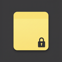

# SecretSticky

**Encrypted sticky notes for Windows and Linux** — the feel of Sticky Notes, with **secrets safe at rest**.

Use it for API keys, passwords, recovery codes, and anything you would not trust to plain Sticky Notes or a synced notepad.

[](https://github.com/AhmiDarrow/SecretSticky/actions/workflows/ci.yml)
[](LICENSE)
[](https://github.com/AhmiDarrow/SecretSticky/releases)

<p align="center">
  
</p>

<p align="center">
  <strong>Local-only · Master password · Multi-window stickies · System tray</strong>
</p>

---

## Why

Windows Sticky Notes is great for quick capture and terrible for secrets (plain local data, sync surface, no real vault). **SecretSticky** keeps the sticky UX and encrypts note titles and bodies on disk.

## Features

| Area | Details |
|------|---------|
| **Vault** | Master password unlock; optional recovery key (shown once at setup) |
| **Crypto** | Argon2id (64 MiB, t=3) + XChaCha20-Poly1305 AEAD |
| **Keys** | Stable content key — change password without re-encrypting notes or killing recovery |
| **Notes** | Multiple colored stickies (incl. black & dark green); the pin keeps a note on top and shows when it is on; long notes scroll (wheel, touchpad, middle-click autoscroll) |
| **Tray** | New note · Show manager · Open all · Lock · Quit |
| **UX** | Single instance (second launch focuses manager); close manager → tray; every sticky has **New note / Manager / Lock** |
| **Clipboard** | Copy secrets with auto-clear (default 30s) |
| **Idle** | Auto-lock after inactivity — 15 min default, **Off–12 h** presets in the manager |
| **Language** | Eleven languages. Follows the system language on first launch (English if unsupported); switch any time from the unlock screen, the recovery screen or manager → Language, applied at once, tray included |
| **Font & size** | Manager → Language: Inter (default), Remedy Sans, Remedy Sans UI, Ahmi Print or Ahmi Pixel, and text size 90–150%, for every window at once |
| **Updates** | Signed updates from GitHub Releases (About → Check for updates) |

## Install

Download from **[Releases](https://github.com/AhmiDarrow/SecretSticky/releases/latest)**.

### Windows

Run `SecretSticky_<version>_x64-setup.exe`: a per-user install (no administrator rights) with Start Menu and optional desktop shortcuts. It takes over an earlier SecretSticky install (0.1.x and 0.2.0, including the MSI) and keeps your notes.

### Linux (x86-64)

Needs glibc 2.28 or newer (Debian 10, RHEL 8, Ubuntu 20.04 and later).

```bash
tar -xzf SecretSticky-<version>-linux-x86_64.tar.gz --strip-components=1 -C ~/.local
```

That installs `~/.local/bin/SecretSticky`, a menu entry and the icon; open SecretSticky from your apps menu.

### Updates

**About → Check for updates** downloads the next release, checks its signature, and restarts the app: Windows runs the new installer, Linux replaces the program. Your notes are never part of an update.

### From source

SecretSticky 1.0 and later is the Rust app in `remedyui/`, built on RemedyUI, Ahmi Darrow's UI engine. RemedyUI is not public yet, so building from source needs a checkout of it: `remedyui/Cargo.toml` finds it in a `Projects/RemedyUI` folder next to the `SecretSticky` folder.

```bash
cd SecretSticky/remedyui
cargo run --release
```

**Requirements:** Rust stable; on Linux the usual X11/Wayland libraries (the app loads them at startup).

## Quick start

1. Launch SecretSticky → create a master password (12+ characters).
2. **Save the recovery key offline** (shown once). Lost password + lost recovery = permanent data loss.
3. Pick a color → sticky opens. Type secrets. The save mark confirms the disk write.
4. Close the manager with **X** → app stays in the tray. Tray → **Quit** to exit fully.
5. Tray → **Lock** when you step away.

## Data layout

```
Windows: %APPDATA%\SecretSticky\
Linux:   ~/.local/share/SecretSticky/
  vault.json      # encrypted note blobs + KDF params (no plaintext titles/bodies)
  vault.json.bak  # last-known-good copy (restored if live is missing/corrupt)
  settings.json   # language, font and text size (not secrets). Unknown keys are kept
```

`--home <dir>` (or `--home=<dir>`) uses that folder instead. `SECRETSTICKY_HOME` does the same when the flag is absent. The flag wins. Updates relaunch with the same arguments, so a custom home stays in use.

- **Encrypted:** note title, note body
- **Plaintext by design:** window geometry, color id, timestamps (so chrome can restore without unlock content)

Durable save path: write + flush temp → snapshot `.bak` → atomic replace into `vault.json` (Windows uses `MoveFileExW` replace-in-place — never delete-then-rename). A crash mid-write must not leave you with zero copies of secrets.

### Updates must NEVER corrupt saved stickies

**Non-negotiable product rule:** installing or updating SecretSticky only replaces the application. Your vault stays where it is and must remain unlockable with the same master password / recovery key after every update. App releases must not wipe notes, rewrite ciphertext incompatibly, or ship changes that leave stickies permanently unreadable. Every release is tested against vaults written by the shipped 0.1.0, 0.1.8 and 0.2.0 code. Full invariant: [SECURITY.md](SECURITY.md).

## Security model

### Protects

- Vault file at rest (disk theft, backups, casual snooping)
- Authenticated encryption of note contents
- Note windows are kept out of screen capture where the system allows it (Windows)

### Does **not** protect

- Malware / keyloggers while unlocked
- A compromised OS or attached debugger

There is **no cloud**, **no account**, and **no backdoor**.

See [SECURITY.md](SECURITY.md) for reporting vulnerabilities.

## Development

```bash
cd remedyui
cargo test            # vault round trips with the shipped versions, every screen, languages, fonts
cargo run             # the app

cd ..
npm run sanitize      # no email addresses, home-folder paths, tokens or keys in tracked files
```

| Path | Role |
|------|------|
| `remedyui/` | The app (1.0+): manager, sticky windows, tray, updater, on RemedyUI |
| `remedyui/tests/fixtures/` | Vaults made by the shipped 0.1.0, 0.1.8 and 0.2.0 code, for round-trip tests |
| `src-tauri/src/crypto.rs`, `vault.rs`, `i18n.rs` | Crypto, on-disk format and catalogs, shared by the app (unchanged from 0.2.0) |
| `src/locales/` | The interface text in eleven languages |
| `src/`, `src-tauri/` | The Tauri app that shipped 0.1.x and 0.2.0 |
| `.github/workflows/` | CI, and signing of releases |

## CI & releases

- **CI** (`.github/workflows/ci.yml`) — on push/PR to `main`: sanitize check, frontend tests + Vite build, Rust fmt + tests.
- **Releases** — the Windows installer and the Linux package are built and tested locally with `cargo remedy package` (Windows) and `cargo remedy package --target linux` (glibc 2.28 via `cargo zigbuild`), then uploaded to a draft release. The **Release** workflow (manual, with the tag) signs them with the updater key (repo secret `TAURI_SIGNING_PRIVATE_KEY`, the key every version since 0.1.2 trusts) and writes `latest.json`.

## Stack

- **Rust** + **RemedyUI** (windows, text, tray, accessibility, updates)
- **Crypto:** `argon2`, `chacha20poly1305`, `zeroize`
- **Updates:** minisign-signed GitHub Releases

## About

Hi I'm Ahmi, hope this helps!

- GitHub: [github.com/AhmiDarrow](https://github.com/AhmiDarrow)
- This project: [AhmiDarrow/SecretSticky](https://github.com/AhmiDarrow/SecretSticky)
- Releases: [github.com/AhmiDarrow/SecretSticky/releases](https://github.com/AhmiDarrow/SecretSticky/releases)
- Support: [patreon.com/cw/AhmiDarrow](https://www.patreon.com/cw/AhmiDarrow) — thank you!

SecretSticky is a small, local-first app for people who live in sticky notes but need real at-rest encryption for API keys and passwords. Built with RemedyUI so the whole app, interface and crypto alike, is Rust.

## License

[MIT](LICENSE) © Ahmi Darrow. The bundled fonts are under the SIL Open Font License 1.1 (`remedyui/assets/fonts/*/OFL.txt`).
